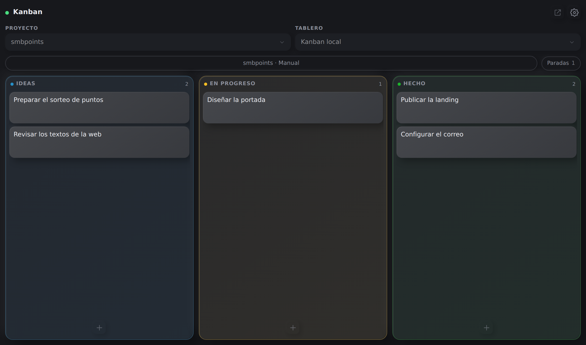
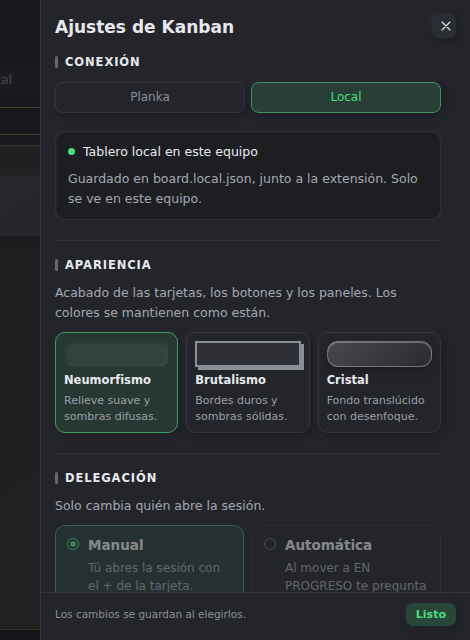
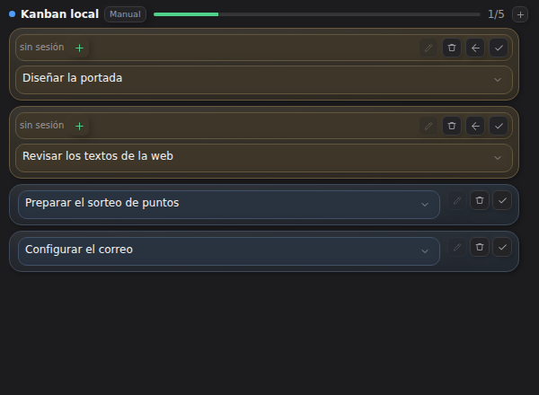
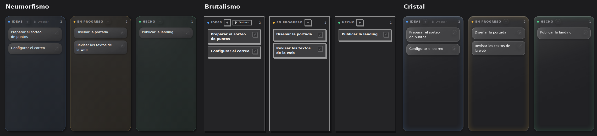

# Kanban para OpenChamber

Español · [English](README.md)

**Un Kanban para [Planka](https://planka.app), y también un tablero local sin Planka.**
Funciona dentro de OpenChamber: tres columnas, una sección en el chat con lo que estás
haciendo y un agente que puede leer y mover tarjetas.

Conéctalo a tu Planka o guárdalo todo en este equipo. La interfaz está en español.



## Qué te llevas

- **Tres columnas**: IDEAS, EN PROGRESO y HECHO. Nada más.
- **Tableros**: crea un tablero de Planka con sus tres columnas desde el panel, o añade
  las columnas a uno vacío.
- **Tarjetas** con título, detalles y una sesión.
- **Sesiones**: la tarjeta sigue a su sesión de OpenChamber mientras trabaja.
- **Manual o automático**: abre la sesión tú, o deja que el agente pregunte antes.
- **Un tablero local por proyecto**: el mismo tablero, sin servidor.
- **Tres acabados visuales** para el tablero.
- **Un agente** que crea, mueve, completa, edita y busca tarjetas.

No es un gestor de proyectos: sin sprints, estimaciones ni informes.

## Instalar

Instálala desde la URL del repositorio. La URL de git es la única instalación que
OpenChamber puede actualizar; las de carpeta y ZIP nunca se actualizan.

```
https://github.com/SMBX7/openchamber-extension-kanban.git
```

1. Abre **Ajustes → Extensiones**.
2. Pega la URL en **Carpeta, ZIP o URL** y pulsa **Añadir**.
3. Revisa los permisos y elige **Permitir y activar**. El icono de **Kanban** aparece
   en la barra lateral derecha; ábrelo desde ahí.

Necesita OpenChamber **2.7.0 o superior**.

### Dónde está

La extensión aparece en tres sitios de OpenChamber, y solo uno se configura:

- **El panel, en la barra lateral derecha.** Es el icono de Kanban. Ahí está el tablero
  y ahí se conecta y se configura: la primera vez pide la conexión con Planka, y después
  **Ajustes de Kanban → Conexión** cambia la cuenta, el servidor o el modo local. Si no
  ves el icono, muestra la barra lateral derecha con «Mostrar u ocultar barra lateral
  derecha».
- **La sección Kanban del chat (Work Status).** Enseña lo que está en progreso y las
  ideas para trabajar sin abrir el panel; no configura nada.
- **La página completa.** Se abre desde **Páginas de extensiones**, encima de la lista
  de sesiones: el mismo tablero a pantalla completa, con la misma configuración.

### Para una IA

- Usa la URL de git de arriba; no descargues un ZIP, no lo clones y no apuntes
  OpenChamber a una carpeta.
- Instálala desde los Ajustes de OpenChamber: la CLI `openchamber` no instala
  extensiones.
- No edites la copia instalada; una actualización la reemplaza.
- Comprueba que **Kanban** está en la barra lateral derecha y que la versión de la tarjeta
  coincide con el `version` del `package.json`.
- Explica cómo actualizar: **Ajustes → Extensiones → Buscar actualizaciones →
  Actualizar**.

### Actualizar

Abrir **Ajustes → Extensiones** comprueba las instalaciones de git una vez por hora;
**Buscar actualizaciones** comprueba al momento. Si hay una versión nueva, pulsa
**Actualizar**; los permisos, las cuentas y los ajustes se conservan. Sin sufijo, la URL
sigue `main`; añade `#v1.2.0` o `#stable` para fijar una etiqueta o una rama. Publicar
una versión es subir el `version` de `package.json` y hacer push.

## Conectar con Planka

La primera vez, el panel pide tres cosas:

| Campo | Qué poner |
| --- | --- |
| Servidor | La dirección de tu Planka, por ejemplo `http://127.0.0.1:3040` |
| Correo o usuario | Tu cuenta de Planka |
| Contraseña | Tu contraseña de Planka |

La contraseña se usa una vez para pedir una llave de acceso y no se guarda. La llave
queda en un archivo de configuración junto a la extensión, en tu equipo, y no se sube a
ningún sitio. Después eliges el tablero de Planka y el proyecto de OpenChamber al que
pertenecen sus sesiones.

## Tablero local

Elige **Local** en **Ajustes → Conexión**. Tienes las tres columnas guardadas en este
equipo.

- Solo tuyo: no se ve desde otro dispositivo.
- Un tablero por proyecto de OpenChamber; al cambiar de proyecto cambias de tablero.
- Planka y local son distintos: no se copia nada entre ellos, y puedes volver a Planka
  cuando quieras sin entrar otra vez.
- **Descargar MD** y **Descargar CSV** escriben `kanban-AAAA-MM-DD.md` y `.csv` en tu
  carpeta de Descargas, para leerlos y compartirlos.
- **Copia JSON** escribe el tablero completo; es el único formato que se puede volver a
  cargar con **Importar copia…**.

El archivo lo escribe la extensión donde corre OpenChamber, no el navegador.



## El panel

Se abre con el icono de **Kanban** de la barra lateral derecha. Aquí también se conecta
con Planka y se cambian los ajustes.

- **Crear**: el `+` junto al título de una columna abre el recuadro encima de las
  tarjetas. Escribe un título y una descripción opcional; `Enter` o **Crear** lo guarda.
  La descripción se queda en una línea y se desplaza en horizontal.
- **Editar**: el lápiz (o `Enter` con la tarjeta enfocada) abre la tarjeta. Ahí cambias
  título, detalles y sesión; **Confirmar** guarda y cierra, **Cancelar** descarta.
- **Borrar**: dentro del editor, pulsa **Eliminar tarjeta** dos veces; tienes cinco
  segundos de **Deshacer**.
- **Mover**: arrastra la tarjeta dentro de una columna o a otra. Al arrastrarla a HECHO
  queda completada; si está vinculada a una sesión, se mueve sola cuando esa sesión
  termina su turno. Lo que muevas a mano no se toca.
- **Ordenar IDEAS**: **Ordenar** abre los cuatro criterios de prioridad.
- **Buscar** con la lupa.
- **Paradas** filtra las tarjetas de EN PROGRESO **sin una sesión activa**.

## Work Status

La sección de Work Status del chat; sirve para trabajar sin abrir el panel de la barra
lateral derecha.



- Todas las tarjetas de EN PROGRESO en ámbar, con sus botones: elegir su sesión,
  abrirla o crear una con `+`; devolver la tarjeta a ideas con la flecha o completarla
  con el tic.
- Los títulos se recortan a dos líneas; pulsa el texto o la flecha para leerlo entero, o
  el lápiz para editarlo.
- La etiqueta **Auto**/**Manual** junto al nombre del tablero cambia el modo.
- El **`+` de la cabecera** añade una idea.
- Debajo, las ideas: el tic empieza una, la papelera la borra (con deshacer).

## Sesiones: manual y automático

Elige el modo en **Ajustes → Delegación** o desde la etiqueta del Work Status.

- **Manual**: mover una tarjeta a EN PROGRESO solo la mueve; abre la sesión con el `+` de
  la tarjeta. Cada tarjeta tiene su propia sesión.
- **Automática**: la delegación automática va por lotes. La primera tarjeta que lanzas
  abre la sesión; las siguientes se suman a esa misma sesión. El agente principal le pasa
  cada tarjeta a un subagente, revisa el resultado y mueve la tarjeta a HECHO él mismo. El
  aviso sigue preguntando antes de abrir nada.

Cuando un agente toma una tarjeta, la extensión la vincula a esa sesión: pasa a EN
PROGRESO al vincularse. Un lote sigue abierto mientras le quede alguna tarjeta fuera de
HECHO; cuando llega la última, la sesión revisa el conjunto, escribe el resumen de lo que
hizo cada subagente y se cierra. En los dos modos:

- Pasar a **HECHO** deja la sesión abierta; **Cerrar sesión/es** en la columna HECHO
  cierra cada sesión distinta una vez y borra sus vínculos.
- Volver a **IDEAS** suelta la tarjeta. En un lote solo sale esa tarjeta: la sesión sigue
  con las demás.
- Una tarjeta sin sesión aparece en **Paradas**.

## Estilos

Se cambian en **Ajustes → Apariencia**.



- **Neumorfismo**: relieve suave, sombras difusas.
- **Brutalismo**: bordes duros, esquinas rectas, sombras sólidas.
- **Cristal**: fondos translúcidos con desenfoque.

## Problemas frecuentes

- **Kanban no aparece en la barra lateral derecha**: actívalo en **Ajustes → Extensiones**
  y recarga OpenChamber.
- **No encuentro dónde configurar la extensión**: no está en la lista de sesiones; el
  icono vive en la barra lateral derecha. Muéstrala con «Mostrar u ocultar barra lateral
  derecha» y abre **Kanban**.
- **El agente no ve las tarjetas**: reinicia OpenCode después de actualizar la extensión.
- **El panel y la sección Work Status no coinciden**: son zonas distintas; recarga
  OpenChamber.
- **El tablero no cambia**: en modo Planka, comprueba que Planka está encendido y que la
  sesión no ha caducado; **Ajustes → Conexión** muestra la cuenta o el error.
- **He borrado una tarjeta sin querer**: **Deshacer** dura cinco segundos.

## Licencia

MIT. Ver [LICENSE](LICENSE).
