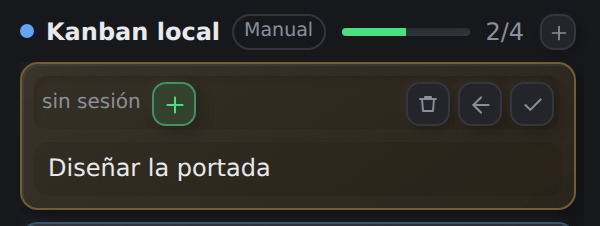
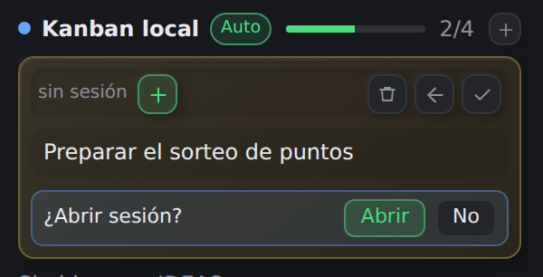
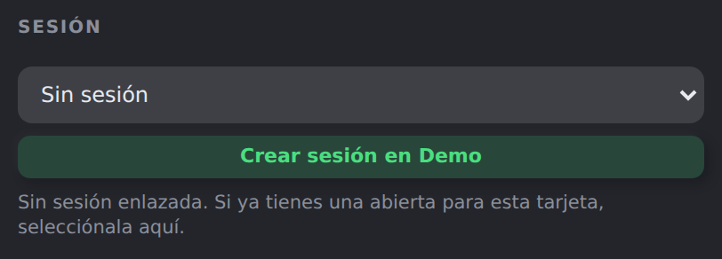
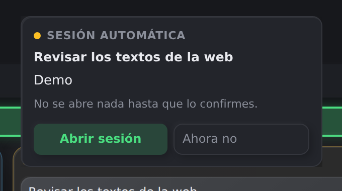

# Kanban for OpenChamber

[Español](README.es.md) · English

**A Kanban for [Planka](https://planka.app), and also a local Kanban without Planka.**
It runs inside OpenChamber: a board with three columns, a small section in the sidebar
showing what you are working on, and an agent that can read and move cards.

Point it at your Planka instance, or choose the local board and keep everything on this
machine: same board, same sessions, no server. If you were looking for a local Kanban
inside OpenChamber, this works that way too.

## What you get

- **Three columns**: IDEAS, IN PROGRESS and DONE. Nothing else.
- **Cards** with a name, description, labels, checklist and due date.
- **Sessions**: each card can carry an OpenChamber session, and you open it from there.
- **Automatic or manual**: let the agent open the session when a card moves, or open it
  yourself.
- **Three visual styles** for the board.
- **An agent** that can create, move, complete, edit and search cards.

It is not a project manager: no sprints, no estimates, no reports.

## Before you start

- OpenChamber **2.7.0 or newer**.
- **Either** a Planka account and its address, **or** nothing: the local board needs no
  server.
- Only if you are going to build the extension yourself: Node.js 20 or newer.

## Install

1. Open **Settings → Extensions** in OpenChamber.
2. Add an extension and pick **this project's folder**.
3. **Kanban** appears in the sidebar. Open it.

There is nothing else to wire: the extension already declares its panel, its section
and its agent tools.

## Connecting to Planka

The first time, the panel asks for three things:

| Field | What to put |
| --- | --- |
| Server | Your Planka address, for example `http://127.0.0.1:3040` |
| Email or user | Your Planka account |
| Password | Your Planka password |

The password is used **once** to request an access key and is not stored. The key does
stay in a configuration file next to the extension, on your machine, and is never
uploaded anywhere.

Then pick the Planka board and which OpenChamber project it belongs to. Sessions for
that board are created in that project.

## Local board

If you do not have Planka, open **Settings → Conexión** and choose **Local**. You get a
board with the three lists and three labels, stored on your machine.

- It is yours only: not visible from your phone or another computer.
- You can go back to Planka whenever you want; you will not have to log in again.
- Planka and local are separate boards: nothing is copied between them.
- **Descargar MD** and **Descargar CSV** save the board to your Downloads folder, to
  read or share it. **Copia JSON** saves a complete copy and **Importar copia…**
  restores it.

## The panel

- **Create**: the `+` at the end of a column. Type and press `Enter`.
- **Edit**: hover a card and press the pencil. There you change the name, description,
  labels, checklist and due date.
- **Delete**: the trash. You have to press it **twice**; then you get five seconds to
  **Undo** in the bar at the top.
- **Move**: drag the card inside a column or to another one.
- **Complete**: the tick sends it to DONE and closes its session.
- **Search** with the magnifier.
- **Paradas** filters cards in IN PROGRESS **with no session**. It is how you see what
  has been parked for a long time and decide whether to pick it up or send it back to
  ideas.

## Work Status

It is the sidebar section. It lets you work without opening the panel.

- At the top, **the card in progress** in amber, with its buttons: pick a session, open
  one with `+`, send it back to ideas with the arrow, or complete it with the tick.
- Next to the board name, a pill says **Auto** or **Manual**; press it to change the
  mode without opening anything.
- The **`+` in the header** adds an idea without leaving the chat.
- Below, the **ideas**: the tick starts one, the trash deletes it (also with undo).

## Sessions: manual and automatic

Choose the mode in **Settings → Delegación** or from the Work Status pill.

- **Manual**: moving a card to IN PROGRESS only moves it. You open the session with the
  card's `+`.
- **Automatic**: when a card reaches IN PROGRESS, a small prompt appears next to it
  asking whether to open the session. Nothing opens until you say yes.

This is how it looks in each place:

| | Manual | Automatic |
| --- | --- | --- |
| **Work Status** |  |  |
| **Panel** |  |  |

In manual mode you have the button to open it whenever you want. In automatic mode,
moving the card shows the prompt and you decide right there.

Everything else works the same in both modes:

- Moving to **DONE** asks the session to close, and it stops.
- Moving back to **IDEAS** stops the session and releases the card.
- Because the card is released, moving it again starts a **new** session, without the
  previous conversation.
- If a card ends up with no session, it shows under **Paradas**: that is where you see
  the ones parked for a long time.

## Styles

The same board with three finishes. Change them in **Settings → Apariencia**.

- **Neumorphism**: soft relief, blurred shadows.
- **Brutalism**: hard borders, square corners, solid shadows.
- **Glass**: translucent surfaces with blur.

## Common problems

- **The agent cannot see the cards**: after updating the extension, restart OpenCode so
  it loads the new version.
- **The panel and the sidebar disagree**: they are two separate areas; reload
  OpenChamber.
- **The board does not change**: in Planka mode, check that Planka is up and that the
  session has not expired. **Settings → Conexión** shows the account or the error.
- **I deleted a card by mistake**: you have five seconds of **Undo**. After that it
  cannot be recovered.
- **There is no sound**: there is none, on purpose.

## License

MIT. See [LICENSE](LICENSE).
