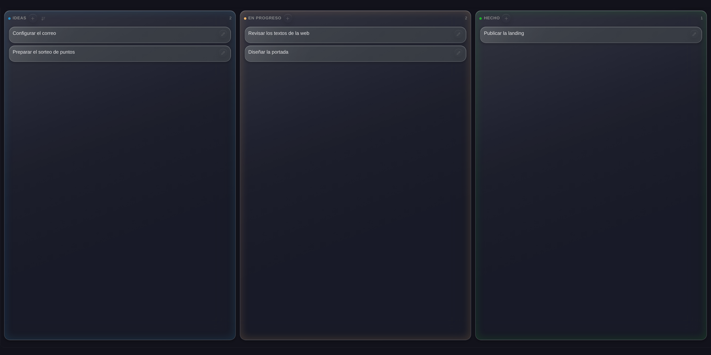
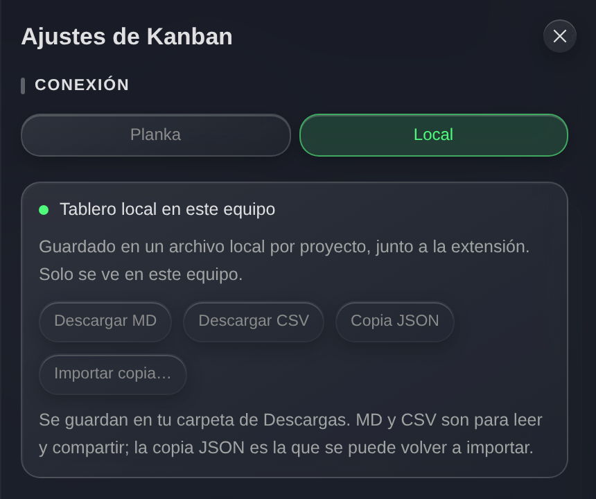
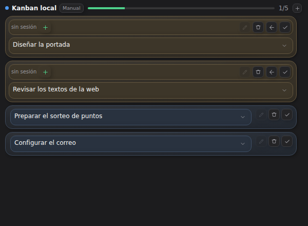
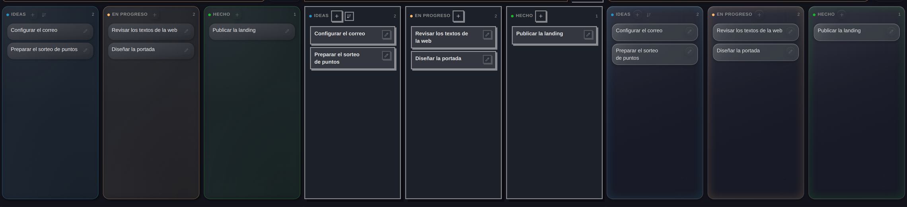

# Kanban for OpenChamber

[Español](README.es.md) · English

**A Kanban for [Planka](https://planka.app), and also a local board without Planka.**
It runs inside OpenChamber: three columns, a section in the chat showing what you are
working on, and an agent that can read and move cards.

Point it at Planka, or keep everything on this machine. The interface is in Spanish;
each control below gives its English name and, in brackets, the label on screen.



## Contents

- [What you get](#what-you-get)
- [Install](#install)
- [Where it lives](#where-it-lives)
- [Updating](#updating)
- [Connecting to Planka](#connecting-to-planka)
- [Local board](#local-board)
- [The panel](#the-panel)
- [Work Status](#work-status)
- [Sessions: manual and automatic](#sessions-manual-and-automatic)
- [Styles](#styles)
- [Common problems](#common-problems)
- [License](#license)

## What you get

- **Three columns**: IDEAS, IN PROGRESS and DONE. Nothing else.
- **Boards**: create a Planka board with its three columns from the panel, or add the
  columns to an empty one.
- **Cards** with a title, details and a session.
- **Sessions**: a card follows its OpenChamber session while it works.
- **Manual or automatic**: open the session yourself, or let the agent ask first.
- **A local board per project**: the same board, no server.
- **Three visual styles** for the board.
- **An agent** that creates, moves, completes, edits and searches cards.

It is not a project manager: no sprints, estimates or reports.

## Install

Install from the repository URL. A git URL is the only install OpenChamber can update;
folder and ZIP installs never update.

```
https://github.com/SMBX7/openchamber-extension-kanban.git
```

1. Open **Settings → Extensions** (Ajustes → Extensiones).
2. Paste the URL into **Folder, ZIP, or URL** (Carpeta, ZIP o URL) and press **Add**
   (Añadir).
3. Review the permissions and choose **Allow and enable** (Permitir y activar). The
   **Kanban** icon appears on the right sidebar; open it from there.

Requires OpenChamber **2.7.0 or newer**.

### Where it lives

The extension shows up in three places, and only one of them is configured:

- **The panel, on the right sidebar.** The Kanban icon there opens the board and its
  settings: the first time it asks for the Planka connection, and later
  **Settings → Connection** (Conexión) changes the account, the server or the local
  board. If you do not see the icon, show the right sidebar with "Show or hide right
  sidebar" (Mostrar u ocultar barra lateral derecha).
- **The Kanban section in the chat (Work Status).** It shows what is in progress and the
  ideas so you can work without opening the panel; it configures nothing.
- **The full page.** Open it from **Extension pages** (Páginas de extensiones), above the
  session list: the same board full screen, with the same settings.

### For an AI assistant

- Use the git URL above; do not download a ZIP, clone it, or point OpenChamber at a
  folder.
- Install it in OpenChamber's Settings: the `openchamber` CLI cannot install extensions.
- Do not edit the installed copy; an update replaces it.
- Check that **Kanban** is on the right sidebar and that the extension card's version
  matches `version` in `package.json`.
- Tell the person how to update: **Settings → Extensions → Check for updates** (Buscar
  actualizaciones) → **Update** (Actualizar).

### Updating

Opening **Settings → Extensions** checks git installs once an hour; **Check for updates**
checks now. When a newer version exists, press **Update**; permissions, accounts and
settings are kept. Without a suffix the URL follows `main`; add `#v1.2.0` or `#stable` to
pin a tag or branch. Publishing a version means bumping `version` in `package.json` and
pushing.

## Connecting to Planka

The first time, the panel asks for three things:

| Field | What to put |
| --- | --- |
| Server | Your Planka address, for example `http://127.0.0.1:3040` |
| Email or user | Your Planka account |
| Password | Your Planka password |

The password is used once to request an access key and is not stored. The key stays in a
configuration file next to the extension, on your machine, and is never uploaded. Then
pick the Planka board and the OpenChamber project its sessions belong to.

## Local board

Choose **Local** in **Settings → Connection** (Conexión). You get the three columns,
stored on this machine.

- Only yours: not visible from another device.
- One board per OpenChamber project; switching project switches boards.
- Planka and local are separate: nothing is copied between them, and you can switch
  back to Planka at any time without logging in again.
- **Download MD** (Descargar MD) and **Download CSV** (Descargar CSV) write
  `kanban-YYYY-MM-DD.md` and `.csv` to your Downloads folder, for reading and sharing.
- **JSON copy** (Copia JSON) writes the complete board; it is the only format that can be
  loaded back with **Import a copy…** (Importar copia…).

The file is written by the extension where OpenChamber runs, not by the browser.



## The panel

It opens from the **Kanban** icon on the right sidebar. This is also where you connect
Planka and change the settings.

- **Create**: the `+` next to a column title opens the card box above the cards. Type a
  title and an optional description; `Enter` or **Create** (Crear) saves it. Both fields
  grow as you type — the title to two lines and the description to four — and scroll
  inside after that. `Shift+Enter` starts a new line.
- **Edit**: the pencil, a double click on the card, or `Enter` with the card focused
  opens the card. There you change the title, details and session; **Confirm**
  (Confirmar) saves and closes, **Cancel** (Cancelar) discards.
- **Session dot**: the small dot left of the pencil shows the session state, and only
  while the card is in IN PROGRESS.
- **Delete**: inside the editor, press **Delete card** (Eliminar tarjeta) twice; you get
  five seconds of **Undo** (Deshacer).
- **Move**: drag a card inside a column or to another one. Dragging to DONE completes it.
  A card with its own session moves there when that session finishes its turn; in a batch,
  the main agent moves it after reviewing its subagent. Manual moves are never touched.
- **Sort IDEAS**: **Sort** (Ordenar) orders by **Speed** (small work first) or
  **Complexity** (redesigns and interface changes first).
- **Search** with the magnifier.
- **Stopped** (Paradas) filters cards in IN PROGRESS **without an active session**.

## Work Status

The Work Status section beside the chat; it lets you work without opening the panel.



- Every card in IN PROGRESS in amber, with its buttons: choose its session, open it, or
  create one with `+`; send the card back to ideas with the arrow, or complete it with
  the tick.
- Titles clamp to two lines; click the text or the chevron to read the whole title, or
  the pencil to edit it.
- The **Auto**/**Manual** pill next to the board name changes the mode.
- The **`+` in the header** adds an idea.
- Below, the ideas: the tick starts one, the trash deletes it (with undo).
- A card in IN PROGRESS with no session shows under **Stopped** (Paradas).

### From the chat

Type `@` in the composer and pick **Tarjetas** (Cards): IN PROGRESS comes first and IDEAS
after, each row labelled with its column. The list stays short — type to search by title
or details, and an exact title comes first. Picking a card that is still in IDEAS moves it
to IN PROGRESS. The chip hands the agent the title, the id, the column and the details, so
it can work the card without opening the panel. Cards in DONE stay out.

## Sessions: manual and automatic

Choose the mode in **Settings → Delegation** (Delegación) or from the Work Status pill.
When you work from a chat, that session is the one that takes the cards: each card goes to
a subagent, and several ready at once run in parallel, each on its own files.

- **Manual**: working a card from the chat links it to that session, so the Work Status
  stops saying it has no session. Open the batch with the `+` in the Work
  Status when you want the agent to take it. Both modes work in batches with subagents.
  The agent works the card and leaves it in IN PROGRESS with a note that it is ready: you
  review it, move it to DONE and ask for the summary when the batch is done. Referencing
  a card in the chat to work on it — with `@` or by name — moves it to IN PROGRESS if it
  is still in IDEAS.
- **Automatic**: the prompt asks before adding each card to the batch, so nothing joins
  silently. The agent reviews each subagent, moves the card to DONE itself and summarises
  when the batch ends; the session stays open for you to archive.

When an agent takes a card, the extension links it to that session: the card moves to IN
PROGRESS when linked. A batch stays open while any of its cards is outside DONE. In
automatic mode, when the last card arrives the session reviews the set and writes the
summary; in manual it waits for you to close the batch from the DONE column. In both modes
the session stays open:

- Moving to **DONE** finishes the card: it stops pointing at its session, so the session
  dot never survives the move and the session stays open for you to archive. Inside a
  batch the cards keep their links until the whole batch is done.
- **Close batches** (Cerrar lote/lotes) in the DONE column asks each linked session for
  its summary once and releases its cards; the session stays open for you to archive.
- Moving back to **IDEAS** releases the card. In a batch only that card leaves; the
  session keeps working the rest.

### The board the agent uses

The panel follows the project of the session it is open in: a session created in a project
shows that project's board, and switching to a session of another project switches the
board. Picking a board in the panel binds it to that project, so the next session shows it
without asking. When a project has several boards and none is pinned, the panel keeps the
board it has instead of guessing. With no project the board stays as you left it.

The panel and the agent are two separate processes. The panel follows the connection you
see here; the agent's tools decide their board from the project the session was opened
in. Bind it once per project with the **pill next to the board selector**: it reads
"Vincular" until you press it, then shows the project's name, and pressing it again
releases the board. While a project has several boards and none is pinned,
the agent refuses to touch cards instead of guessing. A worktree or a subfolder of the
project inherits the pinned board.

## Styles

Change them in **Settings → Appearance** (Apariencia).



- **Neumorphism** (Neumorfismo): soft relief, blurred shadows.
- **Brutalism** (Brutalismo): hard borders, square corners, solid shadows.
- **Glass** (Cristal): translucent surfaces with blur.

## Common problems

- **Kanban is not on the right sidebar**: enable it in **Settings → Extensions** and
  reload OpenChamber.
- **I cannot find where to configure it**: it is not in the session list; the icon lives
  on the right sidebar. Show it with "Show or hide right sidebar" (Mostrar u ocultar
  barra lateral derecha) and open **Kanban**.
- **The agent cannot see the cards**: restart OpenCode after updating the extension.
- **The agent refuses to touch cards**: its board follows the project of the session. Open
  the board you want and press the pin next to the board selector.
- **The panel and the Work Status section disagree**: they are separate areas; reload
  OpenChamber.
- **The board does not change**: in Planka mode, check that Planka is up and the session
  has not expired; **Settings → Connection** shows the account or the error.
- **I deleted a card by mistake**: **Undo** lasts five seconds.

## License

MIT. See [LICENSE](LICENSE).
